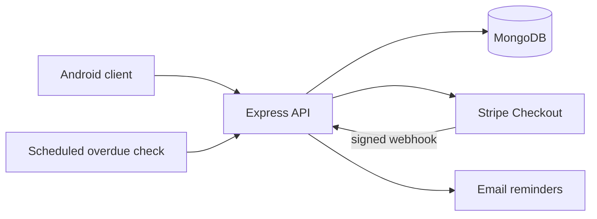

# PowerToGo Backend

> The Node.js API behind the PowerToGo Android power-bank rental prototype.


## Overview

The service manages users, stations, power-bank inventory, payments, rental state, reminders, and administrator actions. Stripe Checkout creates the payment session; a verified webhook moves the selected power bank into the rented state.



## Main capabilities

- register users and query role/ban status;
- seed stations and power-bank inventory;
- check availability by station;
- create Stripe Checkout sessions;
- verify Stripe webhooks and activate rentals;
- list payment history and active rentals;
- return power banks;
- list, ban, and unban users;
- send scheduled overdue reminders;
- generate QR images for station metadata.

## Environment

Create a local `.env` with the variables used by `server.js`:

```env
PORT=4242
MONGODB_URI=
STRIPE_SECRET_KEY=
STRIPE_WEBHOOK_SECRET=
MAIL_FROM=
MAIL_PASSWORD=
```

## Run locally

The source imports the following packages. If starting from this repository as-is, create a package manifest and install them:

```bash
npm init -y
npm install express cors mongoose stripe body-parser node-cron nodemailer dotenv qrcode
node server.js
```

Generate station QR codes with:

```bash
node generateQR.js
```

## Important development settings

- `YOUR_DOMAIN` currently contains a LAN development address and should become an environment variable.
- The reminder schedule and overdue threshold are shortened for testing.
- Stripe CLI can forward local events to `/webhook` during development.

## Security notice

Never commit live credentials. The repository currently tracks an `.env` file; any real values it has ever contained should be rotated, removed from Git history, and replaced with an `.env.example` before public deployment.
